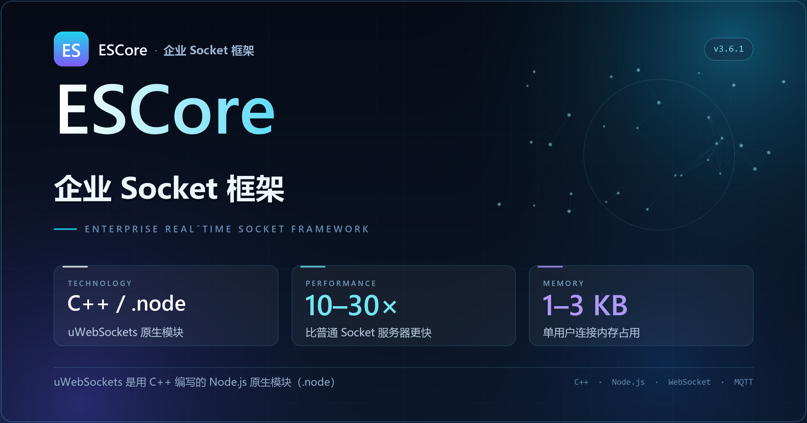

# ESCore · 企业 Socket 框架

> **uWebSockets.js（C++ 原生模块 `.node`）驱动 · 比普通 Socket 服务器快 10–30 倍 · 单用户连接内存占用仅 1–3 KB**

ESCore 是一套面向企业的实时通信与业务中台框架。通信层直接加载 uWebSockets.js 的 C++ 原生模块，
在 Node.js 中跑出接近原生的吞吐；业务层内置账号、商户、订单、支付、权限、定时任务、MQTT 设备接入、
对象存储、短信与微信生态等常用能力，开箱即可搭建企业级实时应用。

---

## 目录

- [框架简介](#框架简介)
- [核心能力](#核心能力)
- [性能与通信内核](#性能与通信内核)
- [技术栈](#技术栈)
- [环境要求](#环境要求)
- [快速开始](#快速开始)
- [MQTT 服务器部署（Docker）](#mqtt-服务器部署docker)
- [config 配置参数说明](#config-配置参数说明)
- [前端环境变量](#前端环境变量)
- [目录结构](#目录结构)
- [常见问题](#常见问题)
- [开源声明](#开源声明)

---

## 框架简介

ESCore 把「实时通信」与「企业业务」拆成两层：

- **通信层**：`uWebSockets.js`（C++ / `.node`）+ `Socket.IO` 协议兼容层 + `Redis Adapter`，
  负责长连接、房间 / 命名空间、消息广播与多实例水平扩容。
- **业务层**：Express 提供 HTTP API，TypeScript 编写的领域模块（用户、商户、门店、订单、支付、
  权限、任务、设备）通过统一的 `io` 上下文装配，API 即插即用。

后端同时监听两个端口：`3011` 承载 HTTP API（含 `/qqMaps` 地图代理），`3012` 承载
uWebSockets + Socket.IO 的实时通道（路径 `/io`）。前端由 Vite 开发服务器代理这两类请求，
生产环境构建为静态资源，由 Nginx 或任意静态服务器托管。

## 核心能力

| 场景 | 说明 |
| --- | --- |
| **企业级实时同步微服务** | 多端状态同步、消息推送、在线状态、房间隔离；Redis Adapter 让多个 Node 实例之间共享广播，可随连接数水平扩容。 |
| **企业中台** | 统一账号体系、商户 / 门店 / 角色权限、订单交易、支付与结算、日志审计，作为业务系统的公共底座。 |
| **AI Agent 接入** | `config.ai` 填入模型服务的 `apiKey / baseURL / model` 后，框架首页即可接入 AI 对话链路，把 Agent 的流式结果通过实时通道推送给前端。 |
| **IoT / 智能设备** | 内置 MQTT 客户端（`libs/sys/mqtt.ts`），支持设备心跳、指令下发与异步回执、网关在线状态落库，配合 EMQX 即可管理海量设备。 |

## 性能与通信内核

| 指标 | 说明 |
| --- | --- |
| 通信内核 | uWebSockets.js —— 用 **C++** 编写的 Node.js 原生模块，以 `.node` 二进制形式被 `require` 加载，绕过 JS 层的事件循环开销。 |
| 吞吐 | 官方基准中，uWebSockets 的请求 / 消息处理能力约为普通 Socket 方案的 **10–30 倍**。 |
| 内存 | 单用户连接的内存占用约 **1–3 KB**，同等内存下可承载更多并发连接。 |
| 协议 | Socket.IO v4（`path: /io`，兼容 `allowEIO3`），前端可使用 `socket.io-client` 直接连接。 |
| 扩展 | `@socket.io/redis-adapter` 广播多实例，PM2 cluster 部署即可横向扩容。 |

> 表中 10–30 倍与 1–3 KB 为官方 / 项目参考指标，实际表现随协议、业务负载、连接模式与硬件变化，
> 请在目标环境中以压测结果为准。

## 技术栈

| 分层 | 选型 |
| --- | --- |
| 前端 | Vue 3 · TypeScript · Vite 4 · Pinia · Vue Router · Element Plus / Vant / Ant Design Vue · ECharts |
| 后端 | Node.js · TypeScript · Express 4 · Socket.IO 4 · uWebSockets.js 20（C++ `.node`） |
| 数据 | MySQL（mysql2 / Sequelize）· Redis（缓存 + Socket.IO Adapter） |
| 设备 | MQTT 5（mqtt.js）· EMQX Broker |
| 构建 / 部署 | vue-tsc + Vite（产物输出 `public/`）· tsc（产物输出 `Node/dist`）· PM2 |

## 环境要求

| 依赖 | 版本建议 | 说明 |
| --- | --- | --- |
| Node.js | 18 / 20 LTS | `Node/src/libs/uWebSockets` 已内置 ABI 83–147 的预编译 `.node`，覆盖 Node 14–24；换版本前先看[常见问题](#常见问题)。 |
| npm | 8+ | 安装依赖、执行脚本。 |
| MySQL | 5.7 / 8.0 | 业务数据存储。 |
| Redis | 6 / 7 | 缓存与 Socket.IO 多实例广播。 |
| Docker | 20+ | 用于一键部署 MQTT Broker（EMQX），**首次启动前必须先部署**。 |

## 快速开始

```bash
# 1. 获取代码并安装依赖
git clone https://github.com/newlan/ESCore.git ESCore
cd ESCore
npm install

# 2. 启动后端（ts-node-dev 热重载，监听 3011 / 3012）
npm run tsd

# 3. 另开一个终端，启动前端（HTTPS，端口 443）
npm run vite
```

启动成功后：

| 服务 | 地址 | 说明 |
| --- | --- | --- |
| 前端 | `https://localhost` | Vite 使用 `vite.config.ts` 内置的自签名证书，浏览器提示「不安全」时选择继续访问。 |
| HTTP API | `http://127.0.0.1:3011/app` | Express 路由，前端 `/api/*` 会被代理到这里。 |
| 实时通道 | `ws://127.0.0.1:3012/io` | uWebSockets + Socket.IO，前端 `/io` 走 WebSocket 代理。 |

### 常用命令

| 命令 | 作用 |
| --- | --- |
| `npm install` | 安装前后端全部依赖。 |
| `npm run tsd` | **后端开发模式**：`ts-node-dev` 监听 `Node/server.ts`，改代码自动重启。 |
| `npm run vite` | **前端开发模式**：Vite 开发服务器，HTTPS `:443`，代理 `/api` 与 `/io`。 |
| `npm run tsc` | 编译后端 TypeScript 到 `Node/dist`（使用 `tsnode.json`）。 |
| `npm run build` | 前端类型检查 + 生产构建，产物输出到 `public/`。 |
| `npm run test` | 预留测试脚本（当前未接入用例）。 |

> `npm run tsd` 中的 `set DEBUG=lan:*` 是 Windows 语法；在 Linux / macOS 上请改为
> `DEBUG=lan:* ts-node-dev --respawn --transpile-only --project ts_node_dev.json ./Node/server.ts`。

### 生产部署

```bash
# 1. 编译后端
npm run tsc            # 产物：Node/dist

# 2. 构建前端
npm run build          # 产物：public/

# 3. 用 PM2 启动（cwd 必须是 Node 目录，pm.json 里是相对路径）
cd Node
pm2 start pm.json
pm2 logs WS            # 查看日志
pm2 restart WS         # 重启
pm2 stop WS            # 停止
```

`Node/pm.json` 的默认策略：进程名 `WS`、`NODE_ENV=production`、cluster 模式 1 实例、
内存超过 4G 自动重启、日志写入 `Node/logs/app-out.log` 与 `app-err.log`。
生产环境请用 Nginx 反向代理 `public/` 静态资源，并为 `/io` 开启 WebSocket Upgrade：

```nginx
location /io {
    proxy_pass http://127.0.0.1:3012;
    proxy_http_version 1.1;
    proxy_set_header Upgrade $http_upgrade;
    proxy_set_header Connection "upgrade";
}
location /api/ {
    proxy_pass http://127.0.0.1:3011;
}
```

## MQTT 服务器部署（Docker）

> ⚠️ MQTT 是设备接入与指令下发的前置依赖，**必须在启动后端之前完成部署**，
> 否则 `libs/sys/mqtt.ts` 会持续重连，设备相关功能不可用。

### 1. 拉取并启动 EMQX

```bash
# 拉取镜像（EMQX 5.x，支持 MQTT 5 / 3.1.1）
docker pull emqx/emqx:5.8.0

# 启动：1883 MQTT、8083 WebSocket、8084 WSS、8883 TLS、18083 控制台
docker run -d \
  --name escore-mqtt \
  --restart unless-stopped \
  -p 1883:1883 \
  -p 8083:8083 \
  -p 8084:8084 \
  -p 8883:8883 \
  -p 18083:18083 \
  -e EMQX_DASHBOARD__DEFAULT_PASSWORD='ESCore@123' \
  -v escore-mqtt-data:/opt/emqx/data \
  emqx/emqx:5.8.0
```

> **Windows PowerShell**：把行尾的 `\` 换成反引号 `` ` ``，或把整条命令写成一行。
> `-v escore-mqtt-data:/opt/emqx/data` 会把数据保存在 Docker 卷中，容器删除后配置与消息不丢失。

### 2. 验证与常用运维

```bash
docker ps --filter name=escore-mqtt            # 确认容器状态为 Up
docker logs -f escore-mqtt                     # 查看启动日志
docker exec -it escore-mqtt emqx ctl status    # 查看 Broker 状态

docker stop escore-mqtt                        # 停机
docker start escore-mqtt                       # 再次启动
docker rm -f escore-mqtt                       # 删除容器（数据卷保留）
```

### 3. 创建连接账号

连接 Broker（见 `libs/sys/mqtt.ts`），需要在 EMQX 中创建同名账号：

1. 浏览器打开控制台 `http://<服务器IP>:18083`，默认账号 `admin`，密码为上一步设置的 `ESCore@123`。
2. 进入 **Access Control → Authentication**，新建 `Password-Based` + `Built-in Database` 认证器。
3. 回到 `Node/config.ts`，把 `lock_server` 改成你的 Broker 地址（例如 `mqtt://127.0.0.1:1883`）。

## config 配置参数说明

后端所有配置集中在 `Node/config.ts`，文件内导出 `debug`（开发）与 `production`（生产）两份对象，
按环境变量 `NODE_ENV` 自动选择：

```ts
const config = process.env.NODE_ENV == 'production' ? production : debug;
export default config;
```

```bash
# Linux / macOS
NODE_ENV=production npm run tsc

# Windows PowerShell
$env:NODE_ENV="production"; npm run tsc
```

### 基础与实时通信

| 参数 | 说明 |
| --- | --- |
| `env` | 环境标识，`D` = 开发、`P` = 生产；同时影响 MQTT 客户端名等环境判定逻辑。 |
| `http_port` | HTTP API 端口，默认 `3011`，Express 与 `/qqMaps` 代理监听此端口。 |
| `http_base` | HTTP 接口基础路径，默认 `/app`。 |
| `wss_port` | 实时通信端口，默认 `3012`，uWebSockets + Socket.IO 监听此端口。 |
| `wss_base` | WebSocket 握手路径，默认 `/io`，**必须与前端代理、Nginx 配置保持一致**。 |

### Redis 缓存

| 参数 | 说明 |
| --- | --- |
| `redis.host` / `redis.port` | Redis 地址与端口，开发环境指向调试服务器，生产环境通常为 `127.0.0.1:6379`。 |
| `redis.pass` | Redis 密码，无密码时留空。 |
| `redis.prefix` | 键前缀（如 `newlan:`），用于多项目共用同一 Redis 时隔离数据。 |

### MQTT / 设备接入

| 参数 | 说明 |
| --- | --- |
| `lock_server` | MQTT Broker 地址，格式 `mqtt://host:1883`；生产环境默认 `mqtt://127.0.0.1:1883`。 |
| `lock_name` | 连接 Broker 时使用的 `clientId`，开发 / 生产分别为 `d_backend_server` / `p_backend_server`，用于区分指令归属环境。 |


### 鉴权与安全

| 参数 | 说明 |
| --- | --- |
| `jwt` | JWT 签名密钥，**上线前务必替换为高强度随机串**。 |
| `wx_auth_type` | 微信授权返回的 ID 类型，`openid` 或 `unionid`。 |
| `devList` | 开发调试用的商户 / 门店 ID 白名单，仅在开发环境生效。 |

### 第三方服务

| 参数 | 说明 |
| --- | --- |
| `sms.accessKeyId` / `sms.accessKeySecret` / `sms.signName` | 阿里云短信的 AK / SK 与签名（默认签名 `ESCore`）。 |
| `ai.apiKey` / `ai.baseURL` / `ai.model` | AI Agent 模型服务配置；填写 `apiKey` 后框架首页开放 AI 对话入口。 |
| `qiniu.AK` / `qiniu.SK` / `qiniu.scope` / `qiniu.url` | 七牛云对象存储的密钥、空间名与访问域名。 |
| `baidu.AppID` / `baidu.APIKey` / `baidu.SecretKey` | 百度智能云（OCR / 语音等）应用凭证。 |

### 微信生态

| 参数 | 说明 |
| --- | --- |
| `wx.appId` / `wx.appSecret` | 公众号 AppID 与 AppSecret。 |
| `wx.wechatRedirectUrl` / `wx.wechatToken` | 网页授权回调地址与开发者 Token。 |
| `wx.sp_mchid` / `wx.merchantId` | 服务商商户号 / 直连商户号。 |
| `wx.apiV3Key` / `wx.paymentKey` / `wx.paymentCertificatePfx` | 微信支付 v3 密钥、v2 验签密钥、证书。 |
| `wx.notify_url` / `wx.notify_url_xy` / `wx.paymentNotifyUrl` | 支付结果回调地址（普通 / 收付通 / 兼容旧版）。 |
| `wx.miniProgram.appId` / `wx.miniProgram.appSecret` | 小程序 AppID 与 AppSecret。 |

> 🔐 **安全提示**：`config.ts` 中的密钥仅作示例，请勿把真实的生产密钥、证书和数据库密码提交到 Git。
> 推荐改用 `.env` + 读取 `process.env` 的方式注入，或在部署机上维护一份独立的 `config.local.ts` 并加入 `.gitignore`。

## 前端环境变量

前端通过 `.env.development` / `.env.production` 注入构建期变量（Vite 仅暴露 `VITE_` 前缀）：

| 变量 | 说明 |
| --- | --- |
| `VITE_APP_TITLE` | 构建标识，开发环境为「开发模式」、生产环境为「生产模式」。 |
| `VITE_APP_WS_URL` | 实时服务地址；开发环境指向本机，生产环境填写正式域名（如 `wss://socket.example.com`）。 |
| `VITE_APP_BBSE` | 环境备注标记，用于区分测试 / 生产构建。 |

在代码中通过 `import.meta.env.VITE_APP_WS_URL` 读取。

## 目录结构

```text
ESCore/
├─ Node/                       后端（TypeScript）
│  ├─ server.ts                入口：Express + uWebSockets + Socket.IO 双端口启动
│  ├─ config.ts                全局配置（debug / production 双环境）
│  ├─ pm.json                  PM2 部署配置
│  ├─ dist/                    tsc 编译产物
│  └─ src/libs/
│     ├─ io.ts                 业务上下文与实时通道装配
│     ├─ uWebSockets/          uWebSockets.js 预编译 .node（含 LICENSE）
│     ├─ sys/mqtt.ts           MQTT 设备接入与指令回执
│     ├─ db/                   数据访问层（SQL / 分页 / 数据表）
│     └─ api/                  业务 API（用户、商户、订单、支付、微信…）
├─ Vue/                        前端（Vue 3 + Vite）
│  ├─ src/                     页面、组件、状态与工具
│  └─ .env.development / .env.production
├─ public/                     前端构建产物（由 Nginx 等静态服务器托管）
├─ types/                      全局类型声明
├─ DOC/                        项目文档与 README 配图（escore-banner.png）
├─ shots/                      本地预览截图（已加入 .gitignore）
├─ vite.config.ts              前端构建、HTTPS 证书与开发代理
├─ tsnode.json                 后端编译配置（outDir: Node/dist）
└─ package.json                依赖与 npm 脚本
```

## 常见问题

**1. 启动时报 `This version of µWS is not compatible with your Node.js build`**

uWebSockets.js 依赖与 Node ABI 版本严格对应的 `.node` 文件。仓库内已内置 ABI 83–147
（Node 14–24）的预编译产物；如果仍报错，说明当前 Node 版本不在列表中，请切换到 LTS 版本，
或删除 `Node/src/libs/uWebSockets` 后执行 `npm i uWebSockets.js` 重新拉取匹配的二进制。

**2. 端口被占用（3011 / 3012 / 443）**

```bash
# Windows
netstat -ano | findstr :3011
# Linux / macOS
lsof -i:3011
```

修改端口时，`Node/config.ts`（`http_port` / `wss_port`）与 `vite.config.ts`（`server.port` 及代理
`target`）需要同步调整。

**3. 前端能打开，但实时消息没有反应**

先确认 Redis 已启动并可用——Socket.IO 的 Redis Adapter 连接失败会阻塞 `app.listen` 之后的初始化；
再检查浏览器控制台中的 WebSocket 是否指向 `/io`。生产环境还需确认 Nginx 已开启 WebSocket Upgrade。

**4. MQTT 连接不上**

`docker ps` 确认 `escore-mqtt` 处于 `Up`，防火墙放行 `1883`，并核对 `config.ts` 的 `lock_server`
与 EMQX 中已创建的 `newlan` 账号密码。

## 开源声明

### 本项目许可

ESCore 的业务代码以 **ISC License** 发布（见 `package.json` 的 `license` 字段）。
你可以自由地用于个人或商业项目，也可以修改、再分发，但请保留原始版权声明与许可声明；
再分发时需附带本声明。

### 第三方组件

本框架站在众多优秀开源项目之上，感谢它们的作者与社区：

| 组件 | 许可证 | 用途 |
| --- | --- | --- |
| [uWebSockets.js](https://github.com/uNetworking/uWebSockets.js) | Apache-2.0 | C++ 通信内核（`Node/src/libs/uWebSockets` 下为官方预编译 `.node`，来源提交 `c70d2e6`） |
| [Socket.IO](https://socket.io/) | MIT | 实时通信协议层与客户端 |
| [Vue 3](https://vuejs.org/) / [Vite](https://vitejs.dev/) / [Pinia](https://pinia.vuejs.org/) | MIT | 前端框架、构建与状态管理 |
| [Express](https://expressjs.com/) | MIT | HTTP 服务 |
| [mqtt.js](https://github.com/mqttjs/MQTT.js) | MIT | MQTT 客户端 |
| [mysql2](https://github.com/sidorares/node-mysql2) / [Sequelize](https://sequelize.org/) | MIT | 数据库访问 |
| [node-redis](https://github.com/redis/node-redis) | MIT | 缓存与 Socket.IO Redis Adapter |
| [EMQX](https://www.emqx.io/) | Apache-2.0 | MQTT Broker（Docker 部署） |
| [Element Plus](https://element-plus.org/) / [Vant](https://vant-ui.github.io/) / [Ant Design Vue](https://antdv.com/) | MIT | UI 组件库 |

其余依赖的许可证请查阅各自仓库或 `node_modules` 中的 `LICENSE` 文件。

### 使用与免责

- uWebSockets / uWebSockets.js 为第三方开源项目，本项目仅作集成使用，与该项目作者无隶属关系。
- 本项目按「现状」提供，不附带任何明示或暗示的担保，包括但不限于适销性与特定用途适用性。
- 因使用或无法使用本框架造成的任何直接或间接损失，作者与贡献者不承担责任。
- 用于生产环境前，请自行完成安全评估、数据备份与合规审查；涉及**支付、微信、短信、设备控制**等能力时，
  请务必替换示例密钥、配置回调域名，并遵守对应平台的开放协议与相关法律法规。
- 提交 Issue / PR 前，请确认代码与日志中不包含真实密钥、证书、用户隐私或生产数据。

### 参与贡献

欢迎通过 Issue 反馈问题、通过 PR 提交改进。贡献即表示你同意以本项目相同的许可证发布你的代码。

---

Copyright © 2024 ESCore · 以开源的方式，把实时通信做到极致。